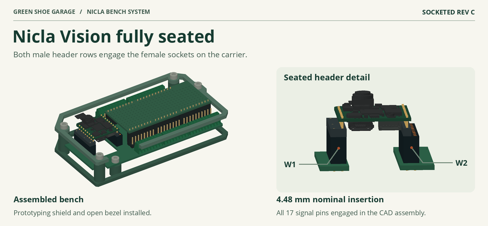
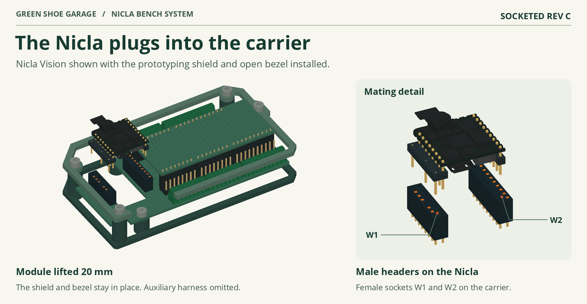

# Green Shoe Garage Arduino Nicla Bench System · Socketed Rev C

The Nicla’s male headers lift out with the module. The W1 and W2 female sockets stay on the carrier. [Assembled stack](docs/previews/nicla-rev-c-stack-assembled.jpg) · [Exploded stack](docs/previews/nicla-rev-c-stack-exploded.jpg) · [Socket assembly and removal](docs/Socket-Assembly.md)

| Arduino Nicla | Dedicated carrier and contact map | Interchangeable shields | Enclosure | Carrier downloads |
| --- | --- | --- | --- | --- |
| **Sense ME** · ABX00050 | [Carrier-Sense-ME](hardware/Carrier-Sense-ME) · [Pin CSV](docs/pinmaps/sense-me.csv) | [Prototype](downloads/Shield-Prototype) · [Blank](downloads/Shield-Blank) | [Base](mechanical/Base.stl) · [Bezel](mechanical/Open-Bezel.stl) | [KiCad / Flux](downloads/Carrier-Sense-ME/Carrier-Sense-ME-KiCad-Flux.zip) · [Gerber / drill](downloads/Carrier-Sense-ME/Carrier-Sense-ME-OSH-Park.zip) |
| **Vision** · ABX00051 | [Carrier-Vision](hardware/Carrier-Vision) · [Pin CSV](docs/pinmaps/vision.csv) | [Prototype](downloads/Shield-Prototype) · [Blank](downloads/Shield-Blank) | [Base](mechanical/Base.stl) · [Bezel](mechanical/Open-Bezel.stl) | [KiCad / Flux](downloads/Carrier-Vision/Carrier-Vision-KiCad-Flux.zip) · [Gerber / drill](downloads/Carrier-Vision/Carrier-Vision-OSH-Park.zip) |
| **Voice** · ABX00061 | [Carrier-Voice](hardware/Carrier-Voice) · [Pin CSV](docs/pinmaps/voice.csv) | [Prototype](downloads/Shield-Prototype) · [Blank](downloads/Shield-Blank) | [Base](mechanical/Base.stl) · [Bezel](mechanical/Open-Bezel.stl) | [KiCad / Flux](downloads/Carrier-Voice/Carrier-Voice-KiCad-Flux.zip) · [Gerber / drill](downloads/Carrier-Voice/Carrier-Voice-OSH-Park.zip) |
| **Sense Env** · ABX00089 | [Carrier-Sense-Env](hardware/Carrier-Sense-Env) · [Pin CSV](docs/pinmaps/sense-env.csv) | [Prototype](downloads/Shield-Prototype) · [Blank](downloads/Shield-Blank) | [Base](mechanical/Base.stl) · [Bezel](mechanical/Open-Bezel.stl) | [KiCad / Flux](downloads/Carrier-Sense-Env/Carrier-Sense-Env-KiCad-Flux.zip) · [Gerber / drill](downloads/Carrier-Sense-Env/Carrier-Sense-Env-OSH-Park.zip) |

**Socketed Rev C** places each 22.86 mm Nicla in an open fork cut to its 8- and 9-pin mounting rows. A 28 mm gate in the bezel opens directly onto the module’s native south-facing connectors. Banks B and E face north. A, C and D face south. Jumper positions sit immediately behind their terminal banks. The separate shield fits alongside the optics and sensors. The Nicla plugs into female W1/W2 sockets on the carrier. A longer, model-coded row of guide pins prevents cross-mating. Its AUX harness disconnects at a separate, latching inline connector. [Socket assembly and removal](docs/Socket-Assembly.md) · [AUX cavity map](docs/Auxiliary-harness.csv)

| Part | Previous Rev A | Socketed Rev C | Reduction in bench footprint |
| --- | --- | --- | --- |
| Carrier PCB, overall | 148.7 × 102.0 mm | **108.8 × 58.0 mm** | **58.4%** |
| Either shield | 94.0 × 56.0 mm | **70.45 × 31.50 mm** | **57.8%** |
| Printed enclosure, assembled | 169 × 130 × 27.2 mm | **117.3 × 66.6 × 21.2 mm** | **64.4%** |

Footprint is overall width × depth. The printed enclosure height excludes screw heads and exposed electronics. The socketed carrier occupies 5,175 mm² inside the routed outline before drilling. Use a Rev C carrier with a matching coded Nicla. The compact Rev B shields, base and bezel also fit. [Measured comparison](verification/size-comparison.json)

## Choose a shield

| Shield | Usable work area | Electrical access |
| --- | --- | --- |
| Prototyping | 27 columns × 8 rows on 2.54 mm centres. All 216 plated holes are individually isolated, with 0.90 mm drills. | Five underside female sockets and 47 separate, labeled top solder pads. |
| Blank | Continuous 69.45 × 20.00 mm rectangle clear on both faces inside a 70.45 × 31.50 mm board. | Same sockets and top pads. The centre is available for custom Flux or KiCad footprints and routes. |

Each carrier has five male jumper banks and five 2.54 mm-pitch Phoenix side-entry screw-terminal banks. Headers H1–H5 are dedicated to the shield, leaving the jumper rows available. Each native contact's route, voltage and direction are in the model CSV. The printable pin cards sit beside the bench. NC and factory positions have their own labeled stations. Their population rules, native-only interfaces and equivalent onboard nets are called out by model. [Bench pin cards](docs/drawings/Bench-pin-cards.pdf) · [Compatibility and source decisions](docs/Compatibility.md)

## PCB downloads

| PCB | Editable package | Fabrication package | Schematic PDF | Board views | Parts |
| --- | --- | --- | --- | --- | --- |
| [Carrier-Sense-ME](hardware/Carrier-Sense-ME) | [KiCad / Flux ZIP](downloads/Carrier-Sense-ME/Carrier-Sense-ME-KiCad-Flux.zip) | [OSH Park ZIP](downloads/Carrier-Sense-ME/Carrier-Sense-ME-OSH-Park.zip) | [Schematic](docs/drawings/Carrier-Sense-ME-schematic.pdf) | [Top](docs/previews/Carrier-Sense-ME-top.jpg) · [Underside](docs/previews/Carrier-Sense-ME-bottom.jpg) | [BOM](hardware/Carrier-Sense-ME/BOM.csv) |
| [Carrier-Vision](hardware/Carrier-Vision) | [KiCad / Flux ZIP](downloads/Carrier-Vision/Carrier-Vision-KiCad-Flux.zip) | [OSH Park ZIP](downloads/Carrier-Vision/Carrier-Vision-OSH-Park.zip) | [Schematic](docs/drawings/Carrier-Vision-schematic.pdf) | [Top](docs/previews/Carrier-Vision-top.jpg) · [Underside](docs/previews/Carrier-Vision-bottom.jpg) | [BOM](hardware/Carrier-Vision/BOM.csv) |
| [Carrier-Voice](hardware/Carrier-Voice) | [KiCad / Flux ZIP](downloads/Carrier-Voice/Carrier-Voice-KiCad-Flux.zip) | [OSH Park ZIP](downloads/Carrier-Voice/Carrier-Voice-OSH-Park.zip) | [Schematic](docs/drawings/Carrier-Voice-schematic.pdf) | [Top](docs/previews/Carrier-Voice-top.jpg) · [Underside](docs/previews/Carrier-Voice-bottom.jpg) | [BOM](hardware/Carrier-Voice/BOM.csv) |
| [Carrier-Sense-Env](hardware/Carrier-Sense-Env) | [KiCad / Flux ZIP](downloads/Carrier-Sense-Env/Carrier-Sense-Env-KiCad-Flux.zip) | [OSH Park ZIP](downloads/Carrier-Sense-Env/Carrier-Sense-Env-OSH-Park.zip) | [Schematic](docs/drawings/Carrier-Sense-Env-schematic.pdf) | [Top](docs/previews/Carrier-Sense-Env-top.jpg) · [Underside](docs/previews/Carrier-Sense-Env-bottom.jpg) | [BOM](hardware/Carrier-Sense-Env/BOM.csv) |
| [Shield-Prototype](hardware/Shield-Prototype) | [KiCad / Flux ZIP](downloads/Shield-Prototype/Shield-Prototype-KiCad-Flux.zip) | [OSH Park ZIP](downloads/Shield-Prototype/Shield-Prototype-OSH-Park.zip) | [Schematic](docs/drawings/Shield-Prototype-schematic.pdf) | [Top](docs/previews/Shield-Prototype-top.jpg) · [Underside](docs/previews/Shield-Prototype-bottom.jpg) | [BOM](hardware/Shield-Prototype/BOM.csv) |
| [Shield-Blank](hardware/Shield-Blank) | [KiCad / Flux ZIP](downloads/Shield-Blank/Shield-Blank-KiCad-Flux.zip) | [OSH Park ZIP](downloads/Shield-Blank/Shield-Blank-OSH-Park.zip) | [Schematic](docs/drawings/Shield-Blank-schematic.pdf) | [Top](docs/previews/Shield-Blank-top.jpg) · [Underside](docs/previews/Shield-Blank-bottom.jpg) | [BOM](hardware/Shield-Blank/BOM.csv) |

Open the extracted project’s `.kicad_pro` in KiCad 9. For Flux, choose **Import → Project** and select the individual KiCad ZIP from the table. Compare the imported outline, net count, connector faces and custom models with the native renders before editing. The Gerber ZIP is a separate two-layer manufacturing input. [Flux KiCad project import](https://docs.flux.ai/Introduction/kicad-to-flux)

## Enclosure and assembly

| Item | Files |
| --- | --- |
| PETG base | [STL](mechanical/Base.stl) · [STEP](mechanical/Base.step) |
| Removable open bezel | [STL](mechanical/Open-Bezel.stl) · [STEP](mechanical/Open-Bezel.step) |
| Editable mechanical design | [Parametric CadQuery enclosure](mechanical/enclosure.py) · [Stack assembly generator](mechanical/assemble_stack.py) |
| Full mechanical assembly | [Vision with prototype shield, STEP](mechanical/Vision-prototype-stack.step) · [All six populated board models, STEP](mechanical/boards) |
| Dimension and orientation references | [Five full-scale fit drawings](docs/drawings/Full-scale-fit-drawings.pdf) · [Exploded view](docs/previews/nicla-rev-c-stack-exploded.jpg) |
| Build instructions | [Parts and hardware](docs/System-BOM.csv) · [Assembly, H2S print settings and first power](docs/Assembly.md) |

The assembled printed frame measures **117.3 × 66.6 × 21.2 mm**, excluding screw heads. The populated Vision/prototype assembly measures **29.99 mm high** in the supplied STEP. The module’s 17 male signal pins unplug from the carrier. The underside fins and auxiliary connectors require the specified leads. Check the unpowered assembly against the contact map before attaching a battery or external power. The blank and prototype shields have the same stack height.

## Verification and editing

All six packaged KiCad projects passed ERC, DRC, schematic-to-PCB parity and unrouted-pad checks. Independent inspection of the Gerber copper and drill data recovered all 47 channels on each PCB. All eight nominal stacks passed the documented interference and access gauges. Both STL files were reopened, dimensioned, checked for watertightness and sliced in Bambu Studio for the H2S. Live Flux import, OSH Park upload, a physical print, assembly and electrical bring-up remain unverified. [Verification matrix and first-article items](verification/README.md)

Use the editable files in `hardware/` for PCB revisions. The scripts in `tools/` rebuild or check the Rev C design and the CadQuery scripts in `mechanical/` regenerate the enclosure. See the documented interpreter requirements before running them. [Reproduction notes](tools/README.md) · [Source manifest](reference/source-manifest.csv) · [Attribution](NOTICE.md) · [SHA-256 file manifest](SHA256SUMS)
